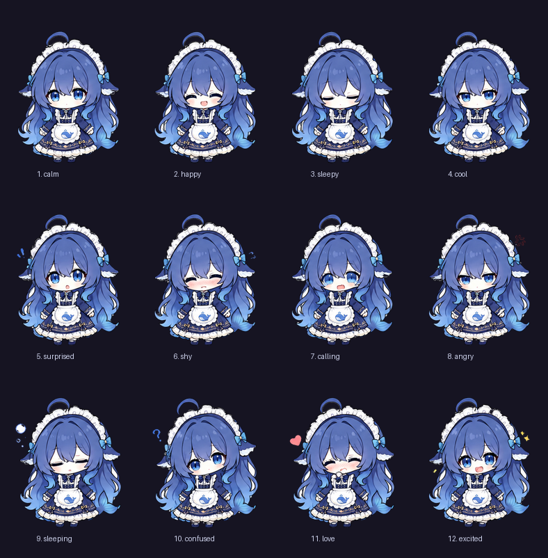

# dsh-pet

**一只住在 DSH（DeepSeek Harness）里的桌面宠物挂件。** 13 张表情差分，跟着鼠标做反应、
能拖能甩、会自己找事做、会打盹，还会顶着气泡说两句。

*A desktop-pet overlay plugin for DSH. It is deliberately **just a pet** —
the AI's status never borrows its face.*


**它只有一件事要做：当一只宠物。** AI 的状态（在跑工具 / 思考 / 出错 / 上下文多满 / 待办进度）
**不占用它的脸**，走标签下面那条独立的细条仪表。



## 环境要求

| | |
|---|---|
| DSH | 桌面版。本插件以 bundle 方式装载（`cordis.patch.yml` + `package.json` 的 `dsh.client`） |
| 运行时依赖 | **零** —— 宿主半边只用 Node 内置模块，浏览器半边只用 DSH 注入的 slot |
| 跑测试需要 | Node.js ≥ 18；`tools/check_eol.py` 与 `tools/make_sheet.py` 需要 Python 3（后者要 Pillow） |

## 安装

本插件不在 npm 上，用 **link** 方式装 —— 好处是改完代码不用重新打包，刷新页面就生效。

**① 把仓库放进插件目录**

```bash
git clone https://github.com/LKMN28256/dsh-pet.git ~/.dsh/plugins/dsh-pet
```

**② 在 DSH 的 profile 里登记**（以 `desktop` profile 为例，文件是
`~/.dsh/profiles/desktop/package.json`）—— 要改**两个**地方，少一个都不会加载：

```jsonc
{
  "dependencies": {
    // ① 依赖指向 clone 出来的目录（Windows 上换成你自己的用户目录名）
    "dsh-pet": "link:C:/Users/<你的 Windows 用户名>/.dsh/plugins/dsh-pet"
  },
  "dsh": {
    "profile": {
      "bundles": [
        // …原有条目…
        "dsh-pet"                                                // ② bundle 清单里点名
      ]
    }
  }
}
```

**③ 建好软链，然后重启 DSH**

```bash
cd ~/.dsh/profiles/desktop && pnpm install
```

> `client.js`（浏览器半边）是**热重载**的，改完刷新页面即可；
> `lib/index.js`（宿主半边）改了**必须重启 DSH** —— 这条踩过坑，见 [踩坑 #6](docs/pitfalls.md#p6)。

## 先跑测试，再相信它装好了

仓库自带**离线测试台**：不用装任何依赖、不需要 DSH 在跑，就能验掉绝大部分逻辑。

```bash
node tools/test_client.js     # 141 项：在 Node 里种一个最小 React 替身，把 client.js 真跑一遍
node tools/test_host.mjs      # 49 项：fake 一个 ctx 直接调路由，宿主改完不用重启就能验
node tools/mutation_check.js  # 29 个变异必须全部"会红"
node tools/scan_undefined.js  # 静态扫"调了没定义的函数"（这类错会让整个桌宠消失）
node tools/verify_live.js     # 端到端：对着已经跑起来的 DSH 验（这一项需要 DSH 在跑）
python tools/check_eol.py     # 全仓必须是纯 LF
python tools/make_sheet.py    # 重新生成上面那张表情总览图（需要 Pillow）
```

**`mutation_check.js` 是这个项目最想给你看的东西。** 它把 29 处关键修复**逐个还原**，
再确认对应的测试真的会失败 —— 一条无论怎么改代码都绿的测试，不叫测试。

同理，`test_host.mjs` 存在的理由是：宿主改一次要重启一次 DSH，而重启会打断正在跑的会话，
所以"重启完再看一眼"是这里最贵的一种验证方式 —— 能提前在 Node 里算完的，就不要留给重启。

## 它现在长什么样

- 挂在 `shell.overlay`（全框浮层，层级高于所有列），默认**右上角**：距右 26px、距顶 9vh
- 高度 **29vh**，等比缩放（素材画布 512×683）
- **立绘本体不吃鼠标**（`pointer-events: none`），只有点击热区按椭圆几何判定
- 底部：呼吸浮动（±5px / 3s）、一个状态标签（标签右侧是 `↻` 手动换表情）
- 头顶：**漫画式台词气泡**（纸面 + 墨线 + 尖尾巴，按情绪换三套配色）
- 标签下方：**AI 状态细条**（一个圆点 + 一条细条 + 一行小字），和脸完全分开
- **脸分时复用**：AI 闲着时脸归宠物，AI 连续忙够 1.5s 才借去做显示屏，闲够 4s 收回
- 可以拖到任意位置，位置存 `localStorage`

## 设计上的分界线：脸 ≠ 仪表

这张脸曾经同时干两份活：宠物 + AI 状态显示屏。两者的出口是**同一条隐式布尔优先级链**
（9 个申请者抢一个表情槽），抢输了还不吭声 —— 于是 bug 长得像"缺席"而不是"错误"，
用户能报告的只能是"凑过去没反应""见不到揉眼睛""睡觉时间有点长"。

现在这条线是硬的：

| | 归谁 | 出口 |
|---|---|---|
| 表情 / 立绘 / 台词气泡 | **宠物自己优先**：手动点击、连点生气、小动作、演示模式、靠近目送、睡觉 | `.dshPetImg` / `.dshPetBubble` |
| 闲下来时的静息脸 | **宠物**：`REST_FACE`（`calm`），**不按定时器换** | `.dshPetImg` |
| AI 忙起来时的静息脸 | **分时借给 AI**：`calling` / `cool` / `surprised` | `.dshPetImg`（`data-dsh-pet-face="ai"`） |
| AI 状态：意图 / 上下文 / todo / 长任务 | **仪表**：一个圆点 + 一条细条 + 一行小字 | `.dshPetMeter` / `.dshPetNote` |

判断标准很简单：**如果一条信息回答的是"AI 在干什么"，它就不该出现在脸上。**

**"分时复用"和当年的"同时抢"不是一回事**：一段时间只有一个主人，而且"现在归谁"是**可见**的
（根节点的 `data-dsh-pet-face`、标签里的 `AI 在忙`、仪表圆点在呼吸）—— 不再靠"安静"表达"我没事"。

## 功能清单

### ① 自主行为（不用等 AI，自己会动）

| 功能 | 触发 | 常量 |
|---|---|---|
| 待机小动作 | 闲置 9s 起，间隔 11~26s 随机 | `IDLE_FIRST_MS` `IDLE_GAP_MIN/MAX` |
| 无聊游走 | 闲置 45s 后自己挪位置，**带踏步动作**（不是平移） | `WANDER_AFTER_MS` `WANDER_X/Y` `WALK_*` |
| 睡觉循环（打盹） | 闲置 90s → 睡 15~30s **自己醒**，醒后 45s 内不再睡 | `SLEEP_AFTER_MS` `SLEEP_NAP_MIN_MS` `SLEEP_NAP_MAX_MS` `SLEEP_AWAKE_MS` |
| 哈欠 / 伸懒腰 / 揉眼睛 | 混在上面的动作池里 | `IDLE_ACTIONS` |
| 忙闲分时复用 | AI 连续忙 1.5s → 脸借去当显示屏；闲 4s 收回 | `FACE_BUSY_DELAY_MS` `FACE_REST_DELAY_MS` `AI_FACE` `REST_FACE` |

小动作共 8 种，全部是 **WAAPI 关键帧**，作用在独立的 `.dshPetAct` 层：
`tiltL` `tiltR` `shake` `hop` `stretch` `lookAway` `yawn` `rubEyes`。

> 哈欠和揉眼睛目前借用 `sleepy` 差分 + CSS 拉伸近似。**有真动作帧后，把 `IDLE_ACTIONS`
> 里那一项的 `expr` 改成新素材 id 即可**，机制不用动。

### ② 鼠标感知

| 功能 | 触发 | 常量 |
|---|---|---|
| 划过吓一跳 | 鼠标速度 >1.7px/ms 且从 250px 内掠过 → 惊讶 + 「！」 | `STARTLE_SPEED` `STARTLE_RADIUS` `STARTLE_COOLDOWN_MS` |
| 靠近抬头 | 进入 190px → 呼喊「看你」+ 气泡 | `NEAR_RADIUS` `NEAR_HOLD_MS` |
| 走远目送 | 退出 380px → 「目送」+ 气泡 | `FAR_RADIUS` `WATCH_AWAY_MS` |

### ③ 拖拽物理

- 拖动时换成**抓狂差分**（真交叉淡入：本体淡出 + 差分淡入），松开淡出
- 松手速度 > `THROW_SPEED` → 进入 rAF 物理循环：**惯性 + 重力 + 落地回弹 + 撞边反弹**
- 重力只作用在竖直方向（越落越快），空气阻力只作用在水平方向 —— 抛物线的形状是对的
- 落地速度够大 → 脚下扬尘 + 抖一下，然后收敛静止
- 静止后位置写进 `localStorage`，刷新还在

### ⑤ 气泡交互（只有宠物会说话）

- 台词气泡：点击 / 靠近 / 走远 / 被甩飞 / 落地 / 睡醒 / 被吓一跳 / 无聊 都会说话
- 连点生气：`MULTI_CLICK_WINDOW` 内点到 **随机** `MULTI_CLICK_MIN`~`MULTI_CLICK_MAX` 下 → 生气并保持 `ANGRY_HOLD_MS`
- 分区反应：**12 个分区**，各有自己的表情和台词（见下表）
- 台词池：**22 个池子 / 168 句**，每个池子 6~17 句 —— `CLICK_LINES`、`BORED_LINES`、
  `WAKE_LINES`、`FLY_LINES`、`LAND_LINES`、`NEAR_LINES`、`AWAY_LINES`、`STARTLE_LINES`、
  `ANGRY_LINES`、12 个分区各自的 `lines`、兜底 `ZONE_FALLBACK.lines`

**两句台词被测试锁死，加词只能往后加、别动第 0 个。** `STARTLE_LINES[0]` 必须是「！」
（测试 6.8 认它），`ANGRY_LINES[0]` 必须是「别戳了！」（测试 6.11 / 6.31 认它）。
这两句各自配一个计数器取下标，**第一次必然是第 0 句**，所以第一句永远不变，
换花样发生在"被吓第二回、戳生气第二轮"之后 —— 实测生气是
「别戳了！ → 说了别戳！ → 再戳就生气了」，吓一跳是「！ → 哇！」。
台词都走 `pick(list, seed)` 取模选词，所以**池子越长越不容易连着撞同一句**；
测试 6.46 会静态扫源码给池子做体检（池内不许重复、不许空句、每句 ≤14 字、
池子不少于 6 句），6.44 / 6.45 分别驱动第二轮生气和第二次被吓，确认真的换句了。

**分手气门槛是随机的，不是写死三次。** 写死 3 的下场是：用户戳两下就知道"第三下必炸"，
于是第三下不再是"她生气了"，而是"我触发了那个开关"。窗口每次重置都重新掷一次，
所以摸不出规律。

点击分区表（`ZONES`，**判定顺序就是数组顺序，先匹配者胜**）：

| 分区 | 位置（相对立绘框的 0~1） | 反应 |
|---|---|---|
| `ahoge` | 呆毛 | 兴奋「别拽呆毛啦——」 |
| `hat` | 帽子蕾丝 | 害羞「唔…别摸头」 |
| `bowR` / `bowL` | 左右蝴蝶结 | 开心「蝴蝶结好看吧」 |
| `face` | 脸 | 困惑「盯着我干嘛」 |
| `handL` / `handR` | 两只手 | 爱心「握手~」 |
| `apron` | 围裙（鲸鱼） | 开心「围裙上有鲸鱼」 |
| `hairL` | 左侧长发 | 惊讶「呀！头发乱了」 |
| `hairR` | 右侧长发 | 呼喊「右边也不行！」 |
| `feet` | 鞋 | 开心「痒！」 |
| `skirt` | 裙摆 | 冷淡「……别掀」 |
| （兜底 `body`） | 椭圆内、以上都不沾 | 开心「干嘛呀」 |

坐标是**量出来的，不是估的**：素材按 0.1 打网格量一遍，改完跑 `node zone_map.js`
把分区框画到立绘上再看一眼。分区是一堆 0~1 的比例数字，光看数字没法确认它落在哪儿。

**气泡长得像漫画里的对话气泡**：近白纸面 + 2px 深色墨线 + 一个朝她指的尖尾巴 +
入场时过冲一下（`cubic-bezier(.34, 1.46, .64, 1)`）。市面桌宠（Shimeji / Live2D 那一类）
的通用长相就是这个"贴纸感"——深色界面上一块近白纸面本身就比半透明深色泡泡显眼得多。

尾巴是 `::after` 画的：**一个转 45° 的方块**，右下两条边当描边、圆角当笔尖。
它上半截被气泡自己的纸面盖住，于是气泡底边那一段墨线被"吃掉"——这正是气泡开口的样子。

按情绪换三套配色，`data-dsh-pet-bubble` 里写着这一次是哪一套：

| kind | 什么时候 | 长相 |
|---|---|---|
| `say` | 平常说话 | 米白纸面 / 深蓝墨 / 倾 -2.2° |
| `shout` | 生气 · 受惊 · 被扔出去 | 暖白纸面 / 红墨 / 更大更粗 / 倾 -3.6° / 尾巴更尖 |
| `soft` | 犯困 · 睡着 · 害羞 | 冷白纸面 / 蓝墨 / 虚线边 / 字重更轻 / 倾 -1.2° |

> **气泡 = "她在说话"，仪表提示 = "系统在报数"，两者不共用通道。**
> AI 的报错 / 上下文告警 / 任务进度走 `.dshPetNote`（细条下面那行小字），**不借她的嘴**。
> 这个区分是刻意的：混在一起时，用户分不清"是她在讲还是系统在报数"。

### ⑧ DSH 数据联动 —— 全部搬进细条仪表

数据全部来自宿主真实状态，不是编的。仪表由三个部件组成：

| 部件 | 显示 | 来源 / 阈值 |
|---|---|---|
| 圆点 | 当前 AI 状态（颜色；只有"正在动"的状态才呼吸） | `intent` → `error` 红 / `tool` 蓝 / `thinking` 紫 / `longtask` 黄 / `waiting` 灰 / `idle` 暗 |
| 细条 | 上下文占用 | `tokenMeter.measure()` ÷ `requestContext().contextWindow`；≥`PCT_WARN`(60%) 转黄，≥`PCT_HOT`(75%) 转红 |
| 小字 | `Todo 2/5` · `137s` 之类 | 最近一次 `todo_write` 的 `completed/total`；长任务从 `taskSince` 起算 |

越过阈值时在细条下方弹一行 `.dshPetNote`（"上下文 82% 快满了" / "还在跑 · 137s"），
`NOTE_MS` 后自己消失；**宠物的表情在此期间完全不受影响**。

### ⑨ 音效 —— 做过两版，都被否了，现在是安静版

`client.js` 里没有任何音频代码，宿主也没有 `/dsh-pet/sfx/` 路由，`assets/` 下没有 wav。
**想加回来之前先把 [踩坑 #25](docs/pitfalls.md#p25) 读完** —— 同样的路已经走过两遍。

| 版本 | 做法 | 用户的判决（原话） |
|---|---|---|
| 一 | WebAudio 现场合成：锯齿波当声带 + 三个带通当共振峰 + 颤音 + 气声 | 「音效太机械了帮我模拟出真人的拟声词'音效」 |
| 二 | 本机 Windows 中文女声（Huihui / Yaoyao）念拟声字，离线抬到萝莉音区，存 7 个 WAV | 「太难听了音效全都回滚吧不要了」 |

留这一段不是记仇，是不让第三个人再来一遍。**结论不是"换个做法再试"，而是：
这条需求在没有真人配音资源之前不该再接。**
## 表情决策链（只剩 7 个申请者）

```text
手动点击 > 连点生气 > 动作自带表情 > 演示模式 > 靠近/目送 > 睡觉 > [AI 借来的脸] > 静息脸
```

前面六个**全是宠物自己**，在"闲"和"忙"两种模式下都优先 —— 也就是说 **AI 再忙也压不住
互动和睡觉**。`[AI 借来的脸]` 只在忙模式且有驻留时间保证时才拿到槽位；它拿不到时是
`REST_FACE`（`calm`）。

标签会写明是谁在控制：`· 手动` / `· 生气` / `· 睡着了` / `· 看你` / `· 目送` / `· 待机` /
`· AI 在忙` / `· AI 出错了`；拖动时是 `抓狂 · 拖拽中`，飞出去时是 `被扔出去了`。

根节点的 `data-dsh-pet-face` 直接说明"现在这张脸归谁"：`pet` 或 `ai`。**测这个，别测表情** ——
忙模式下的静息脸也叫 `calling`，而宠物随时可能打个哈欠把表情换成 `sleepy`。

> **AI 状态不在这条链的"同时竞争"里**，这正是上面那条分界线要解决的问题。历史上它有 9 个
> 申请者、其中两个是"宿主意图"，而且是**同时**抢；五个最顽固的 bug（靠近没反应 /
> 见不到小动作 / 睡觉一睡不醒 / 睡着了还打哈欠 / 报错改写表情）全是那条链的产物。

## 数据从哪来

宿主路由 `GET /dsh-pet/__mind` 返回 `{ ok, digest }`，`digest` 字段：

| 字段 | 含义 |
|---|---|
| `intent` | `error` / `tool` / `thinking` / `waiting` / `idle` / `longtask` |
| `tool` | 最近一次工具名（仪表提示从 `TOOL_LINES` 里选一句人话） |
| `error` | 新鲜报错（30s 内且未被后续成功覆盖） |
| `todos` | `{ done, total, at }` 或 `null` |
| `meter` | `{ used, limit, pct }` 或 `null`（`ctx.tokenMeter.measure()` 的真实返回是 `{ totalTokens, surfaceTokens, nodes }`，这里只取 `totalTokens`） |
| `taskSince` / `turnSince` | **绝对时间戳**，不是"已经过了多久" |
| `running` `turnEnded` `userJustSpoke` `pendingToolCall` | 回合边界判定 |

**为什么是绝对时间戳**：`__mind` 按 `seq` 缓存 digest，缓存命中的那次会被直接复用；
写成相对毫秒就成了过期数字。绝对时间戳由客户端自己减，缓存多久都不会错。

客户端每 `MIND_POLL_MS` 轮询一次，`infoKey()` 做数值指纹，**只在可见值变化时才 setState**。

## 目录与部署

| 位置 | 作用 |
|---|---|
| `~/.dsh/plugins/dsh-pet/` | **插件包真身**（`client.js` + `lib/index.js` + `assets/`） |
| `~/.dsh/profiles/desktop/node_modules/dsh-pet` | Junction，指向上面 |
| `~/.dsh/profiles/desktop/package.json` | `dependencies` 里 `link:` + `dsh.profile.bundles` 里的 `dsh-pet` |

测试台与工具都在本仓库的 `tools/` 里，**默认对着本仓库这份代码**跑（想改测"正在运行的那份插件"，
用下面的环境变量指过去即可）：

- **测试** —— `test_client.js`（141 项断言）、`test_host.mjs`（宿主 `sessionDigest` 49 项断言，
  **不重启 DSH 也能验证 ⑧ 的三项**）、`mutation_check.js`（**变异测试**：把 29 处关键修复
  逐个还原，确认对应测试真的会红）、`scan_undefined.js`（未定义引用静态扫描）、
  `check_eol.py`（全仓行尾必须是纯 LF）
- **实盘** —— `verify_live.js`（**实盘验收**：素材逐张取、`__mind` 字段判据、`__events`、`__diag`；
  重启 DSH 前后各跑一次即可确认新代码已加载）
- **看得见的东西** —— `preview_bubbles.js`（**气泡预览页**：从 `client.js` 的 `CSS_TEXT` 现抠
  气泡 CSS，生成可以直接双击打开的 `bubble-preview.html`；改完样式重跑一次即可）、
  `zone_map.js`（**分区覆盖图**：从 `client.js` 现抠 `ZONES` 表，把每个分区框画到立绘上存成
  `zone-map.png`；改完分区边界跑一次，别靠脑补坐标）、`make_sheet.py`（README 那张表情总览图）
- **立绘生产**（绿幕切图那套，**不在本仓库**）：`process_green_grid.py`、`process_drag.py`（绿幕源）、
  `process_drag_fullbody.py`（**米白底源**：背景和角色身上的白围裙/白蕾丝太接近，不能按亮度切，
  只能从四边洪水填充；角色有闭合描边所以不会漏进身体里）、
  `measure_scale.py`、`fix_ahoge.py`（呆毛内圈去白块，见 [踩坑 #21](docs/pitfalls.md#p21)）


```bash
node tools/test_client.js     # 141 项；末尾会打印 hook 槽位数，必须是 58
node tools/test_host.mjs      # 49 项；fake 一个 ctx 直接调路由，不需要重启
node tools/mutation_check.js  # 29 个变异必须全部"会红"
node tools/verify_live.js     # 对着已经跑起来的 DSH 做端到端验收
node tools/preview_bubbles.js # 生成 bubble-preview.html，双击看气泡长相
node tools/zone_map.js        # 生成 zone-map.png，看点击分区落在哪儿
python tools/check_eol.py     # 全仓必须纯 LF（CRLF 会让变异锚点静默失配）
```

> 路径都能用环境变量覆盖：`DSH_PET_CLIENT` / `DSH_PET_ASSETS` / `DSH_PET_LIB`
> （`mutation_check.js` 就是靠这个把测试指向临时目录里的变异体的）。

## 路由

| 路由 | 作用 |
|---|---|
| `GET /dsh-pet/sprite/<name>.png` | 13 张素材（白名单 `ALLOWED`，**加新素材必须登记，否则 404 且界面无声无息**） |
| `GET /dsh-pet/__mind` | 会话状态摘要（内容驱动 + 数据联动数据源） |
| `GET /dsh-pet/__events` | 最近 60 个事件（排查意图判定） |
| `GET /dsh-pet/__diag?data=...` | 客户端崩溃时回传堆栈 → `%TEMP%\dsh-pet-diag.log` |
| `GET /dsh-pet/` | 服务探针（`hits` / `sprites` 清单） |

## 踩过的坑

**25 条，一条都没删** —— 只是全文挪到了 [`docs/pitfalls.md`](docs/pitfalls.md)（症状 / 根因 / 怎么改 / 怎么验），
这里留一张表方便扫。改这个插件之前值得看一眼：这些坑**都不报错**，
只表现为"桌宠不见了""凑过去没反应""睡太久"这类沉默的缺席。

如果只看三条：

- **[#6](docs/pitfalls.md#p6)** —— `client.js` 改完刷新页面就行，`lib/index.js` 改完**必须重启 DSH**（重启会打断正在跑的会话，所以能提前在 Node 里算完的别留给重启）
- **[#17](docs/pitfalls.md#p17)** —— 用 python 写过文件，整个文件会变成 CRLF，**变异测试里含换行的锚点会静默失效**
- **[#18](docs/pitfalls.md#p18)** —— 症状像产品 bug 时，**先怀疑测试台**

| # | 坑 |
|---|---|
| [1](docs/pitfalls.md#p1) | React #311：hook 数量不一致 → 条目被永久退位 |
| [2](docs/pitfalls.md#p2) | 拖拽相关的三个"过期闭包"陷阱 |
| [3](docs/pitfalls.md#p3) | 加了 `clip-path` 会连"显示"一起裁掉 |
| [4](docs/pitfalls.md#p4) | 素材路由加白名单后，忘了登记 = 静默失效 |
| [5](docs/pitfalls.md#p5) | 素材缓存：`no-cache` + 版本号 |
| [6](docs/pitfalls.md#p6) | 改动生效方式：客户端热重载，宿主必须重启 |
| [7](docs/pitfalls.md#p7) | 呼吸动画要用 CSS，不要用 JS 定时器 |
| [8](docs/pitfalls.md#p8) | 分层要留"空的 transform 通道" |
| [9](docs/pitfalls.md#p9) | 淡入淡出不要只叠不藏 |
| [10](docs/pitfalls.md#p10) | 中文标签检测：颜色比形状可靠 |
| [11](docs/pitfalls.md#p11) | 夹取位置时，左边必须用"宠物宽度"，不能用"窗口宽度" |
| [12](docs/pitfalls.md#p12) | 甩不出去：`releaseVelocity` 的窗口两端取反了 |
| [13](docs/pitfalls.md#p13) | 靠近没反应：`nearExpr` 被 AI 的内容表情永久压住 【已由"脸 ≠ 仪表"结构性消除】 |
| [14](docs/pitfalls.md#p14) | 游走"像平移"：位移有过渡，但没有踏步动作 |
| [15](docs/pitfalls.md#p15) | 睡着之后"一睡不醒"：其他动作全被永久挡住 |
| [16](docs/pitfalls.md#p16) | 测试台不会自己重渲染：一次 advance 推太久，效果和真机不一样 |
| [17](docs/pitfalls.md#p17) | 用 python 改过文件之后，整个文件变成 CRLF |
| [18](docs/pitfalls.md#p18) | 假渲染器必须像真 React 一样摊平数组子节点 |
| [19](docs/pitfalls.md#p19) | 用 `ops_bash` heredoc 跑 python 改 JS 源码时，转义会被剥两层 |
| [20](docs/pitfalls.md#p20) | 抛出去之后是"匀速下落"：竖直方向也吃了空气阻尼 |
| [21](docs/pitfalls.md#p21) | 11 张素材里，呆毛内圈被填了一块突兀的白 |
| [22](docs/pitfalls.md#p22) | "生硬的每四秒钟切换一次表情"：一个没有原因的表情变化 |
| [23](docs/pitfalls.md#p23) | 气泡原来是"一块圆角半透明板子"，而且一加类测试就查不到 |
| [24](docs/pitfalls.md#p24) | "生气次数总是固定在三次" + "只有三个分区有点少" |
| [25](docs/pitfalls.md#p25) | 音效做了两版都被否：合成音"太机械"，真人录音"太难听" |
| [26](docs/pitfalls.md#p26) | "桌宠不见了、也点不动"：`loaded` 永远为假 + 允许只露 60px |

## 怎么在没有重启的情况下验证宿主改动

⑧ 的三项（上下文压力 / todo 进度 / 长任务计时）都在宿主里，**必须重启 DSH 才生效**。
但"重启一次"会打断正在跑的会话，所以宿主逻辑用 `test_host.mjs` 在 Node 里直接验：

它 fake 一个 `ctx`（`logger` / `webServer.register` 捕获 handler / `effect` / `get`），
`await import()` 真正的 `lib/index.js`，然后拿假 `res`/假 `sessions` 调路由处理器，
把 `sessionDigest()` 的每个输出字段都算一遍。这么做的意义是：
**重启之前就能确定宿主代码是对的，把"重启"从"试错"变成"确认"**。

三个容易踩的点：

- `apply(ctx)` 末尾会调 `ctx.effect(...)` 注册清理，**fake ctx 少了 `effect` 会直接抛**
- `sessionDigest` 里 `taskSince` / `turnSince` **必须是绝对时间戳**，不能是相对毫秒：
  `__mind` 有 `mindCache`（`sid` + `seq` 命中就直接回缓存），相对毫秒会在缓存命中时
  冻结成过期数字，界面上就变成"一直显示跑了 300 秒"
- `ctx.tokenMeter.measure(session)` 的真实返回是 **`{ totalTokens, surfaceTokens, nodes }`**，
  而 `TokenUsage.totalTokens` 在类型上是**可选**字段。所以这句兜底不能省：

  ```js
  const used = Number(m.totalTokens) || 0     // 少了 || 0，pct 就是 NaN
  ```

  少了它界面上会显示「上下文 NaN%」——不报错，只是静默显示一个荒谬的数字。
  `test_host.mjs` 的 H7 专门喂了一个"没有 totalTokens"的返回值来钉这条。

## 想改什么，改哪里

| 想改 | 改哪 |
|---|---|
| 位置 / 大小 | `SHIFT_RIGHT` `SHIFT_TOP` `HEIGHT_VH` `MARGIN_KEEP` |
| 能被推到屏幕外多少 | **默认一点都不能**：`clampToView()` 与 `startPhysics()` 的 `minX/maxX` 都要求整只留在视口内（`MARGIN_KEEP` 只在"窗口比桌宠还小"时当兜底）。改这两处必须同步，只改一处就会出现"推出去回不来" |
| 呼吸幅度/速度 | `BREATH_PX` `BREATH_SEC` |
| 小动作频率 | `IDLE_FIRST_MS` `IDLE_GAP_MIN/MAX` |
| 多久开始游走 | `WANDER_AFTER_MS` `WANDER_STEP_MS` `WANDER_GAP_MS` `WANDER_X/Y` |
| 多久睡觉 / 睡多久 | `SLEEP_AFTER_MS` `SLEEP_NAP_MIN_MS` `SLEEP_NAP_MAX_MS` `SLEEP_AWAKE_MS` `SLEEP_BREATH_SEC` |
| 鼠标灵敏度 | `NEAR_RADIUS`(190) `FAR_RADIUS`(380) `STARTLE_SPEED` `STARTLE_RADIUS` |
| 甩出去 / 飞行的手感 | `THROW_SPEED`(0.35) `VEL_WINDOW`(110) `VEL_GRACE_MS`(60) `GRAVITY`(竖直) `AIR_FRICTION`(水平) `MAX_VY`(3.2) `BOUNCE` `WALL_BOUNCE` `REST_SPEED` `MAX_SPEED`(4.5) |
| 走路样子 | `WALK_STEP_MS`(620) `WALK_BOB_PX`(3) `WALK_TILT_DEG`(1.8) `WANDER_STEP_MS`(3200) |
| 落地震动门槛 | `LAND_SHAKE_SPEED` |
| 连点判定 | `MULTI_CLICK_WINDOW` `MULTI_CLICK_MIN`(3) `MULTI_CLICK_MAX`(6) `ANGRY_HOLD_MS` |
| 点击分区 | `ZONES` 表（顺序即优先级，`mx`/`my` 是相对立绘框的 0~1）；改完跑 `node zone_map.js` 看一眼 |
| 宠物气泡 | `BUBBLE_MS` `NOTE_QUIET_MS`（刚提示过就让位） |
| 气泡长相 | `CSS_TEXT` 里的 `.dshPetBubble` 那一段：`--dshPetPaper` `--dshPetInk` `--dshPetTilt`；三套配色见 `.dshPetBubble` / `Shout` / `Soft`，换哪句说什么情绪看 `bubbleKind` |
| 气泡尾巴位置 | `.dshPetBubble::after` 的 `left`（默认 24px，Shout 17px） |
| 宠物台词文案 | `CLICK_LINES` `ZONES[].lines` `ZONE_FALLBACK.lines` `BORED_LINES` `WAKE_LINES` `FLY_LINES` `LAND_LINES` `NEAR_LINES` `AWAY_LINES` `STARTLE_LINES` `ANGRY_LINES`（后两个的第 0 句被 6.8 / 6.11 / 6.31 认死，加词只能往后加） |
| 仪表文案 | `TOOL_LINES` `INTENT_LABEL` |
| 仪表配色 / 呼吸 | `AI_STATE_COLOR` `AI_STATE_PULSE`（只有"正在动"的状态才呼吸） |
| 仪表提示节奏 | `NOTE_MS`(2600) `ERROR_NOTE_GAP_MS` `SPACE_NOTE_GAP_MS` `BUSY_NOTE_GAP_SEC` `BUSY_NOTE_FIRST_SEC` |
| 上下文阈值 | `PCT_WARN`(0.60 转黄) `PCT_HOT`(0.75 转红) `PCT_SPACE_ALERT`(0.80 明说"快满了") |
| 轮询频率 | `MIND_POLL_MS` |
| 忙闲分时复用 | `REST_FACE`（闲时那张脸）`AI_FACE`（忙时按意图映射）`FACE_BUSY_DELAY_MS`(1500) `FACE_REST_DELAY_MS`(4000) |
| 换素材 | 覆盖 `assets/<id>.png`（512×683、透明底、本体底边 y≈653、水平中心 x≈255）并 +`ASSET_VERSION`，然后跑 `python fix_ahoge.py --check <素材目录>`（呆毛内圈不能有白块，见 [踩坑 #21](docs/pitfalls.md#p21)） |
| 加表情 | 素材丢进 `assets/`，`lib/index.js` 的 `ALLOWED` 登记，再往 `EXPRESSIONS` 加一行 |

## 卸载 / 回滚

```powershell
# 先退出 DSH
$prof="$env:USERPROFILE\.dsh\profiles\desktop"
Remove-Item -LiteralPath "$prof\node_modules\dsh-pet" -Force
Remove-Item -LiteralPath "$env:USERPROFILE\.dsh\plugins\dsh-pet" -Recurse -Force
Copy-Item -LiteralPath "$prof\package.json.bak-20261009-230801" -Destination "$prof\package.json" -Force
```

## 已知限制

- ~~"内容"= AI 的思考原文，我盘算怎么测你的时候表情也会跟着变~~ —— **这条已随"脸 ≠ 仪表"
  消失**：脸不再读 AI 的任何文本，"AI 在干什么"现在只影响那条细条仪表。
- `pickActiveSession` 按 **seq 最大**选会话。**同时开多个会话时可能选错**。
- 立绘活在 DSH 窗口内的 `shell.overlay` 浮层，**无法创建独立置顶窗口**——
  宿主没有暴露任何 window/Electron 能力，所以"爬到桌面上"做不到。
- 哈欠 / 揉眼睛 / 伸懒腰目前是 CSS 拉伸近似，不是真动作帧。
- 13 张素材共约 4.9MB，首次加载略重（之后有版本号缓存）。
- 素材改过三次（两次换 `drag` 差分、一次抠呆毛内圈白块）。要退回旧图：直接覆盖 `assets/`，
  再把 `client.js` 的 `ASSET_VERSION` 加 1（**不加版本号，浏览器不会重新取图**）。

## License

MIT，见 [LICENSE](LICENSE)。`assets/` 下 13 张立绘属于本仓库，一并按 MIT 授权。
